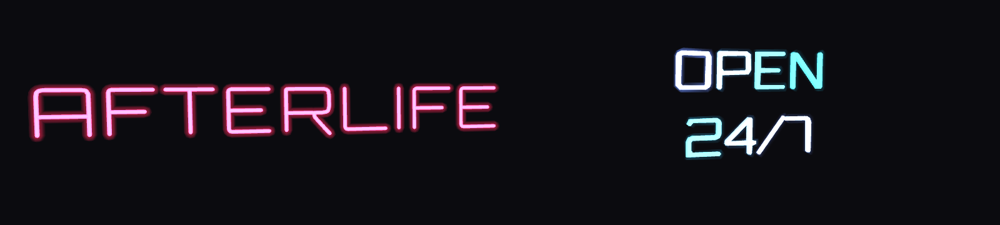

# Neon Signs

3D neon lettering for Unity. Type a text, pick a font, and get real glowing tubes in your scene, with a shader that flickers, hums and glows like the real thing.



- **Neon Text window**: any text and any TTF/OTF font become a 3D tube mesh, live in the scene as you type.
- **Two looks**: round glass tubes, or square LED strips with sharp corners. Optionally open-backed for wall signs.
- **`Custom/Neon` shader**: white-hot core, soft halo and a matte glass look when a tube is off. It works on any mesh, not just text.
- **Flicker built in**: hum, broken letters, glitches, a power-on sequence, chase lights, colour cycling.
- **No runtime scripts**: the result is a plain mesh and material, ready for prefabs and AssetBundles (including Tabletop Simulator).

Requires the Built-in Render Pipeline. Made with Unity 6. TextMeshPro is not needed.

## Install

**Package Manager (Git).** Open *Window → Package Manager → + → Add package from git URL…* and enter:

```
https://github.com/CellPot/neon-signs.git
```

Append a tag to pin a version, e.g. `…/neon-signs.git#v1.0.0`. Git must be installed. To get the examples, select *Neon Signs* in the Package Manager, open *Samples*, and import *Examples*.

**Unity package.** Download `NeonSigns_x.y.z.unitypackage` from Releases and double-click it. Everything, examples included, goes to `Assets/NeonSigns`.

## Quick start

1. **GameObject → Neon Text** creates a sign and opens the *Neon Text* window.
2. Type your text and choose a font and style. The sign updates as you type.
3. Click **Save…** and pick where the mesh goes. The object is now an ordinary mesh, ready to use.

To edit a sign later, select it and the window loads its text and settings. For ready-made signs, see the *Neon Examples* prefab in the examples.

## Neon Text window

| Setting | |
|---|---|
| **Text** | Multi-line text. |
| **Font** | Any TTF/OTF in the project. Use **Add…** or drop a font file onto the window to add one. |
| **Style** | *One line*: one tube along each stroke, classic neon. *Outline*: a tube around each letter, for bold fonts. |
| **Profile** | *Round*: glass tube. *Square*: flat LED strip with sharp corners. |
| **Back** | *Full*: visible from every side. *Open*: front half only, for signs on a wall, with fewer vertices. |
| **Font size** | Size of 1 em in Unity units. |
| **Tube thickness, spacing, align** | Tube thickness and spacing are relative to the font size. |
| **Broken letters** | Letters that flicker on their own, e.g. `7` or `2, 7` (counting letters only). |

## Material: `Custom/Neon`

| Group | Settings |
|---|---|
| **Tube** | Colour, Brightness, White-hot core, Edge falloff, Unlit glass |
| **Halo** | On/off (off removes the halo passes entirely), Size, Strength, Direction (*Along normals*, or *From object centre* for boxy meshes) |
| **Flicker** | Hum, Broken letters, Glitches per minute, Power-on cycle, Chase, Second colour. Set any of them to 0 to turn it off. |

The shader works on any mesh: a tube modelled in Blender, a game model, even a cube. Flicker runs letter by letter on signs made with the window; other meshes flicker as a whole. Copies of a sign flicker out of sync.

## Tips

- Thin fonts suit *One line*, bold fonts suit *Outline*. In *Outline*, a letter whose strokes are thinner than the tube is built as *One line* automatically.
- Kerning is not applied, so tune *Letter spacing* instead.
- A sign with a halo is drawn in 4 passes, and in 1 without. Turn the halo off for distant or numerous signs.

## License

The code (shader and editor scripts) is under the [MIT License](LICENSE.md).
The fonts in `Fonts/` (Orbitron, Tilt Neon, Monoton) are under the SIL Open Font License 1.1; see the `*-OFL.txt` file next to each font.
